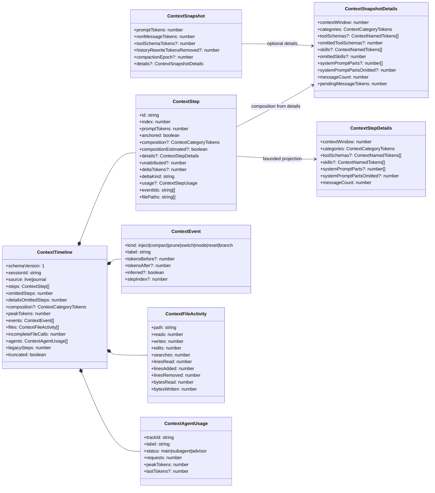
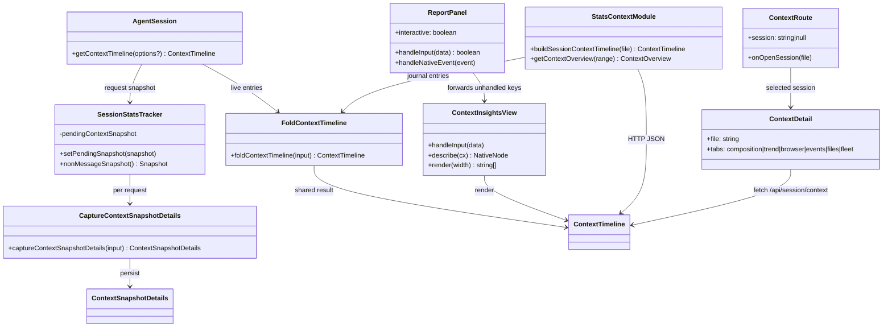
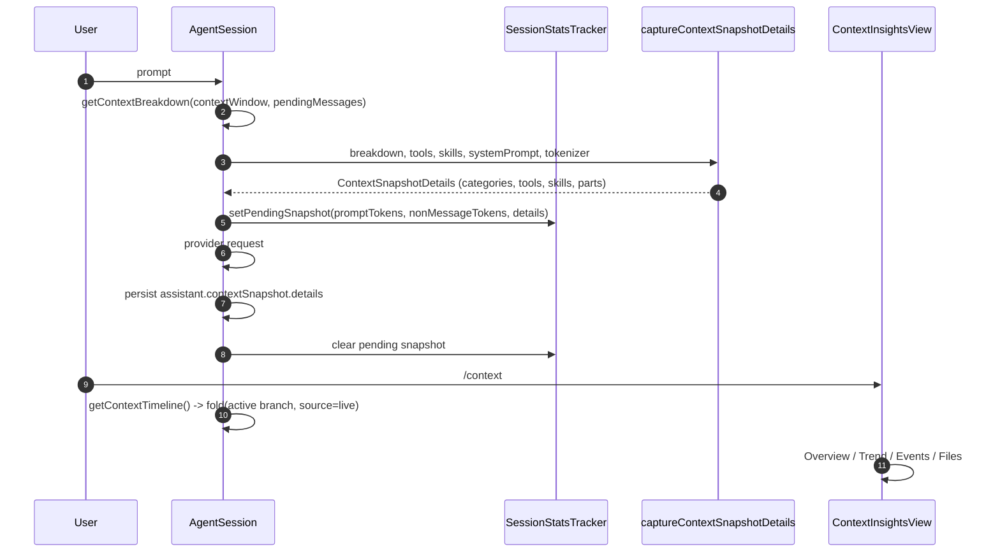
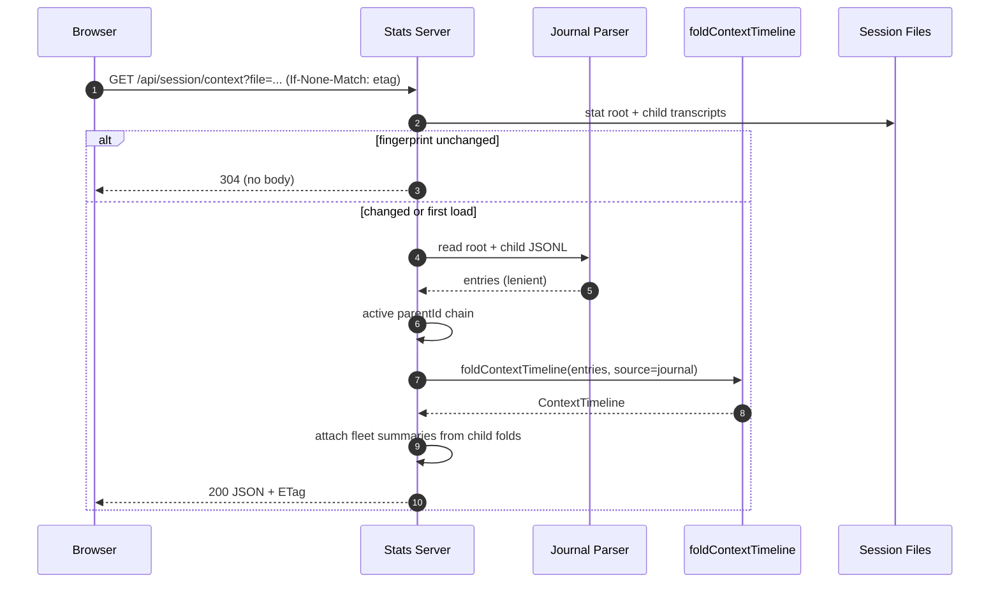
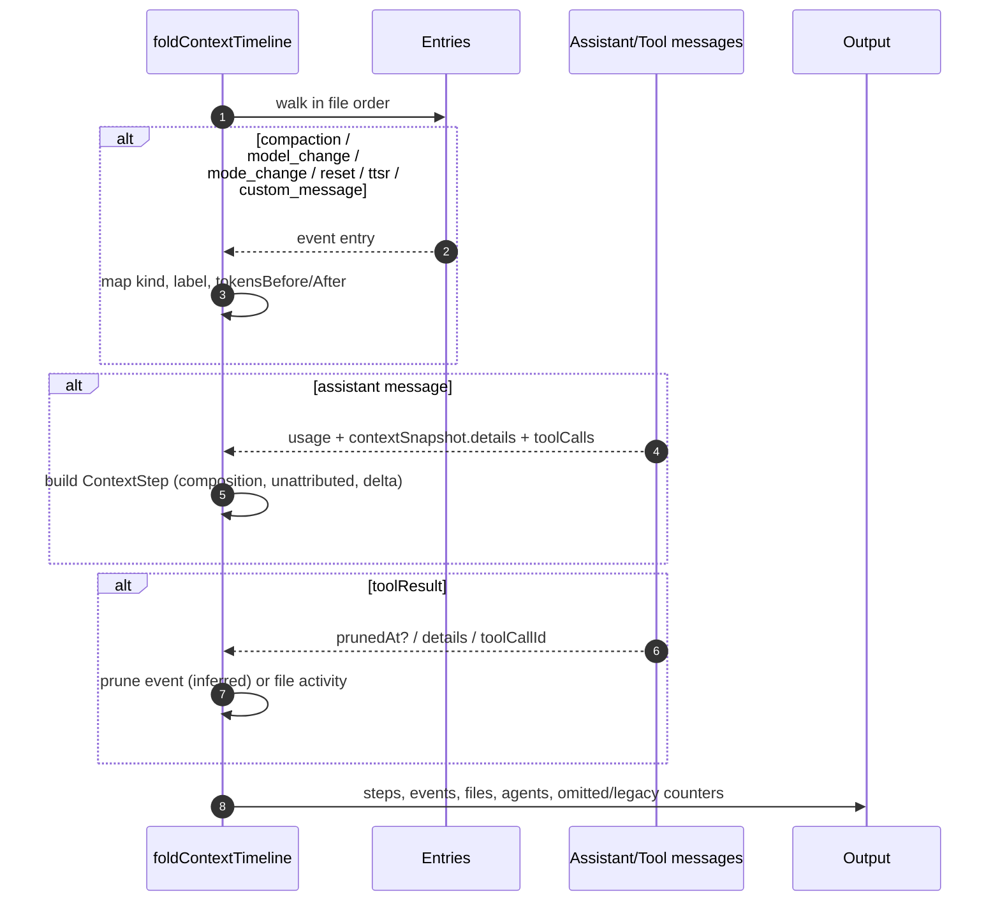

# Context insights — 类图与时序

本文只画结构与调用关系；字段契约见 `接口文档.md`。

## 1. 类型与模块

## 2. 运行时组件

## 3. 时序：实时请求到 TUI

## 4. 时序：stats 单会话与 ETag

## 5. 时序：事件与文件归并

## 6. 模块依赖规则

- `@oh-my-pi/pi-ai` **不**依赖 `pi-agent-core`、`pi-tui`、`pi-coding-agent` 或 `omp-stats`；fold 只用本地类型。
- `coding-agent` 可以依赖 `pi-ai` 与 `pi-tui`；捕获明细使用 TUI 的 tokenizer 辅助函数。
- `omp-stats` 只依赖 `pi-ai`/`pi-catalog`/`pi-utils`，**不** import coding-agent；journal 结构按接口文档镜像。
- TUI 组件只依赖 `pi-ai` 类型、`pi-tui` 组件与主题，不读盘、不发 HTTP。
- Web 组件只通过 `client/api.ts` 访问服务端；共享类型只做 type-only re-export。
